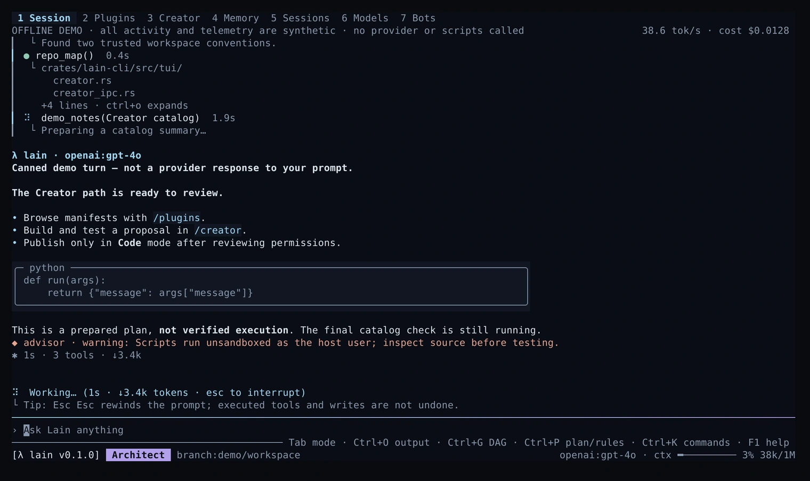

# lain


Lain runs agents locally through a Rust daemon. The terminal UI streams replies and tool calls.
For a single prompt, `lain run` reports what the tools could verify. Lain connects to a local or
remote OpenAI-compatible endpoint and stores memory in SQLite.

[Try the offline demo](#try-the-offline-demo) · [Connect a model](#connect-a-model) · [Browser dashboard](dashboard/README.md)



*Offline demo. The conversation and tool activity are simulated.*

## Try the offline demo

Build from source with a current Rust toolchain. The demo needs no model, credentials or running daemon.

```sh
git clone https://github.com/lainarchive/lain.git
cd lain
cargo install --locked --path .
lain tui demo
```

Use a terminal at least 120 columns by 30 rows to see the sample turn after you type a prompt and
press Enter. If another executable named `lain` is already on PATH, use
`cargo run --locked -p lain -- tui demo` from this checkout.

## Connect a model

Start your model server, then save `lain.json` in the workspace you want Lain to use. Replace the model
name and URL with values from your server:

```json
{
  "provider": {
    "kind": "open_ai_compatible",
    "base_url": "http://127.0.0.1:11434/v1",
    "api_key_env": null
  },
  "model": "your-installed-model",
  "system_prompt": "Check results before claiming completion.",
  "temperature": null,
  "max_turns": 8,
  "max_consecutive_tool_errors": 3,
  "memory_context_limit": 5,
  "coding_session": false,
  "allow_creator_mode": false,
  "budget": {}
}
```

For a remote provider, set its `base_url` and put the name of an environment variable in `api_key_env`.
Keep the key value out of JSON. Full configuration is in the [Rust CLI guide](crates/lain-cli/README.md).

Run `lain doctor` from that workspace to check the toolchain, IPC endpoint, dashboard port and model
connection. It returns 1 if any check fails and does not start a model server. Use `--json` for
machine-readable diagnostics. Then start the daemon:

```sh
lain daemon
```

In another terminal:

```sh
lain tui
```

Or make one request:

```sh
lain run "Say hello in one sentence."
```

`tui` and `run` autospawn a daemon if needed. An existing daemon keeps its original cwd, config and
environment; restart it to change those. `--config PATH` / `LAIN_CONFIG` override the config path;
`--endpoint PATH` / `LAIN_IPC_ENDPOINT` override IPC. The database defaults to `.lain/memory.db`,
overrideable with `LAIN_MEMORY_DB`.

`run` streams text, then prints an evidence report. `--json` emits one JSON report without streamed text.

| `run` exit | Meaning |
| --- | --- |
| 0 | Turn completed; every step verified within its stated `claim_boundary`. |
| 2 | Turn completed with unverified steps. A reply-only greeting normally lands here. |
| 1 | Failure: provider/tool error, cancellation, disconnect or incomplete turn. |

Shell tools are disabled by default. `LAIN_ALLOW_SHELL=1` in the daemon's environment enables Bash on
Unix or PowerShell on Windows. Plugin/Creator grants are separate. Script and CLI backends run as the
host user, without an OS sandbox. Release builds disable Creator unless `allow_creator_mode` is set;
plugin discovery requires `read_fs` in `plugin_permissions`. Creator and script/CLI plugins require all
four grants: `read_fs`, `write_fs`, `network`, `subprocess`. Review source before enabling them.

## Architecture

```text
lain tui ----+
             +--> IPC <----------------------> daemon
lain run ----+    Windows: \\.\pipe\lain-ipc       AgentRunner per session
                  Unix: domain socket           model provider + tool dispatch
                           ^                    broadcast AgentEvents
                           |                       |             |
                           +--- mapped IPC events -+             v
                                                      Axum 127.0.0.1:4040
                                                      /ws/events + HTTP API
                                                                 |
                                                                 v
                                                       browser dashboard

daemon services
  +-- lain-memory: SQLite
  |     episodic: transcript episodes, including untrusted text
  |     procedural: locally synthesized rules; FTS5 retrieval
  +-- lain-context: tree-sitter outlines
  |     cached by language + SHA-256 leaf hash
  +-- lain-plugin / Creator: manifest discovery, grants, test/publish
        .lain/plugins/ and .lain/tools/; webhook / CLI / script backends

library APIs
  lain-context: SHA-256 Merkle tree (available to callers)
  lain-harness (not a daemon parallel scheduler)
  +-- StepReport evidence --> lain run
  +-- DAG + WriteScope + ScopeGuard --> caller-installed runner guard
  +-- detached Git worktrees --> offline dogfood integration test
```

Unix IPC uses `$XDG_RUNTIME_DIR/lain-ipc.sock`, falling back to `<temp_dir>/lain-ipc-<user>.sock`.
There is no TCP fallback. On disconnect the TUI keeps its draft, marks work interrupted and retries
with bounded backoff. Reconnection starts a fresh session; the old session cannot be resumed.

IPC and the dashboard receive events from the same runner; their wire formats differ. IPC maps them
into session/tool events and opt-in token deltas. The WebSocket carries raw `AgentEvent` envelopes.
The daemon starts Axum by default; `--no-ui` disables it. An occupied port warns without stopping IPC.

Build static assets using the [dashboard guide](dashboard/README.md); Axum serves `dashboard/out/`.
Its printed local URL contains an authentication token. Keep it private.
In the TUI, `/dashboard` (also in the command palette) opens the Bots status card,
which shows the login URL when the bridge is up. Autospawn saves daemon stderr in a fresh user-state
log: `$XDG_STATE_HOME/lain/`, then `$XDG_RUNTIME_DIR/lain/`, then `~/.local/state/lain/` on Unix;
`%LOCALAPPDATA%/lain/` on Windows. Unix log files are created with mode 0600. Logs contain credentials.
`/api/` and `/ws/events` require that token with host/origin validation; `/healthz` exposes service/protocol identification with
host/origin checks.

Memory retrieval uses SQLite FTS5; there is no embedding backend. Context parsing covers Rust,
TypeScript and TSX. `coding_session: true` attaches an outline to the first model request and enables
`repo_map` refreshes, so the provider receives workspace names, signatures and doc summaries. The Merkle
tree is a library API; the live outline cache keys individual source hashes, not a persistent repo root.

The harness supplies evidence transitions, lexical scopes, DAG validation, worktrees, bounded repair
helpers, stream abort/restart and frozen transcript bytes. Callers wire these APIs into execution.
Ordinary daemon turns are serial; opening a TUI DAG drawer does not start parallel workers. Lexical
scopes do not resolve symlinks or sandbox subprocesses. Core has no builtin path-only file writer;
the dogfood test registers a fixture writer behind the real runner's guard hook.

## Crate map

| Crate | Role |
| --- | --- |
| `lain` (root) | Installed binary, thin call to `lain-cli`; executable and dogfood integration tests. |
| `lain-cli` | Commands, daemon, Ratatui, Axum, `run` reports and `doctor`. |
| `lain-agent` | Model/tool loop, streaming, cancellation, budgets, events, memory reflection and optional tool guard. |
| `lain-core` | Provider protocol, OpenAI-compatible transport, tool registry and builtins. |
| `lain-ipc` | Versioned newline-delimited JSON over Windows named pipes or Unix sockets. |
| `lain-memory` | SQLite records, episodes, procedural rules, trust checks and FTS5 search. |
| `lain-context` | Token budgeting, SHA-256 Merkle trees, tree-sitter outlines, source-hash cache and AST locations. |
| `lain-plugin` | Manifest/schema validation, capability grants and webhook/CLI/script backends. |
| `lain-harness` | Evidence, DAGs, write scopes, worktrees, repair, advisors and stream/transcript utilities. |

## Evidence model

```text
planned --prepare()--> prepared_not_observed --verify(evidence)--> observed_verified
```

Each `StepReport` carries a `claim_boundary`. Preparation records that work was done; verification
requires nonempty test/compiler evidence with zero exit codes. Failed evidence leaves the report
unverified. `run` qualifies only builtin Bash/PowerShell commands with exit codes actually reported by
the daemon, using the live tool inventory to check provenance. A plugin named `bash` cannot qualify by
name alone. This verifies reported command execution, not every assertion in the assistant's reply.

The [offline dogfood test](tests/dogfood_evidence_loop.rs) commits a broken crate, locates a function
through its AST, edits it through a scripted real runner in a worktree, rejects forbidden writes, and
runs Cargo before and after the fix. It uses a private target directory and `--offline`; local execution
took 0.68 seconds.

## Terminal controls

<details>
<summary>Text previews of the launch screen and a sample turn</summary>

These shortened transcriptions come from 140×45 test renders. They omit color and variable metadata.

Launch screen:

```text
1 Session  2 Plugins  3 Creator  4 Memory  5 Sessions  6 Models  7 Bots
OFFLINE DEMO - all activity and telemetry are synthetic

                            L A I N
lain v0.1.0 - /workspace - demo/workspace
+-- session --------------------------+  +-- get started ---------------------+
| openai:gpt-4o - Architect            |  | /creator   build a tool            |
| session demo-local-01               |  | /plugins   browse tools            |
| Last session unknown                |  | /theme     switch look             |
|                                     |  | ?          every shortcut          |
+-------------------------------------+  +------------------------------------+
+-- active tools - 7 -------------------------------- /plugins to find tools --+
| builtin / creator     create_tool  test_tool                                 |
| builtin / execution   bash                                                  |
| builtin / memory      memory_read                                           |
| builtin / workspace   repo_map                                              |
| plugin echo           demo_echo                                             |
| plugin notes          demo_notes                                            |
+----------------------------------------------------------------------------+
> Ask Lain anything
Tab mode - Ctrl+O output - Ctrl+G DAG - Ctrl+P plan/rules - Ctrl+K commands
```

Session transcript, after the first demo submission:

```text
1 Session  2 Plugins  3 Creator  4 Memory  5 Sessions  6 Models  7 Bots
OFFLINE DEMO - all activity and telemetry are synthetic
> Inspect the plugin workflow and prepare a safe Creator plan.
| * memory_read(Creator publishing workflow)  0.4s
|  + Found two trusted workspace conventions.
| * repo_map()  0.4s
|  + crates/lain-cli/src/tui/
|      creator.rs
|      creator_ipc.rs
|    +4 lines - ctrl+o expands
| ... demo_notes(Creator catalog)  2.0s
|  + Preparing a catalog summary...

lain - openai:gpt-4o
Canned demo turn - not a provider response to your prompt.
The Creator path is ready to review.
  [assistant prose and Python example omitted]
This is a prepared plan, not verified execution. The final catalog check is still running.
advisor - warning: Scripts run unsandboxed as the host user; inspect source before testing.
* 2s - 3 tools - 3.4k received tokens
> Ask Lain anything
```

</details>

| Key / command | Screen |
| --- | --- |
| `1` / `/session` | Session: streaming transcript, tools and optional drawers. |
| `2` / `/plugins` | Plugins: manifests, tools, permissions, `/` filter and `r` refresh. |
| `3` / `/creator` | Creator: draft, schema, sample arguments, Test and confirmed Publish. Enablement/grants required; publishing requires Code mode. |
| `4` / `/memory` | Memory: read-only episodes/rules with list, detail and local `/` filter. |
| `5` / `/sessions` | Sessions: daemon snapshot and session table; `r` refresh. |
| `6` / `/models` | Models: context/usage and readable local config; change models in config. |
| `7` / `/bots` | Bots: session activity, daemon metadata and memory counts; refreshes every five seconds while visible. |

Digits switch screens when not composing; Alt+Left/Right switches screens. Ctrl+K opens the palette;
`?` or F1 opens help. In Session, Tab cycles idle Architect/Code/Ask modes. Architect and Ask restrict
execution to concrete builtin read tools. Ctrl+O expands tool output, Ctrl+G toggles the DAG, Ctrl+P
toggles plan/rules. Esc closes overlays first; in Session it interrupts. Esc Esc rewinds the turn and starts fresh on the next
submission. Rewind does not undo side effects or stored episodes. Ctrl+C quits; `q` quits with an empty
composer. The composer grows for multiline drafts and scrolls beyond six visible rows.

Sessions and Bots are read-only: Enter reports that attaching an existing session is unavailable.
The daemon has no pricing source; live cost is unknown. Per-session directional usage, age and cost
columns are omitted when unavailable. Memory shows entries read rather than storage capacity. Creator's Test/Publish can run
host code; review source and permissions before confirming.

<details>
<summary>Theme palettes</summary>

Values come from [`theme.rs`](crates/lain-cli/src/tui/theme.rs). `wired` uses fixed RGB:

| Role | Hex | Role | Hex |
| --- | --- | --- | --- |
| Background | `#0a0d14` | Panel | `#111722` |
| Text | `#dae4ef` | Muted | `#8897ae` |
| Cyan | `#9fd8fa` | Blue | `#84b6e6` |
| Green | `#8fc9b3` | Red | `#ef9b98` |
| Violet | `#b3a0ee` | Amber | `#e8a391` |
| Peach | `#d8aa9f` | Shadow | `#2b354c` |

`mono` uses ANSI entries, not fixed RGB. These conventional hex equivalents are references; the
terminal's palette controls actual colors.

| Mono roles | Ratatui color / ANSI entry | Conventional hex |
| --- | --- | --- |
| Background, panel | Black / 0 | `#000000` |
| Text, red/amber/peach accents | White / 15 | `#ffffff` |
| Muted, cyan/blue/green/violet accents, gradient | Gray / 7 | `#c0c0c0` |
| Shadow | DarkGray / 8 | `#808080` |

</details>

## Earlier Node CLI

The earlier Node CLI is also named `lain`. Installing both can put the wrong executable first on PATH.
Its task, approval and extension workflows remain documented in [docs/CLI.md](docs/CLI.md); its separate
terminal dashboard is in [docs/ui/README.md](docs/ui/README.md). Rust launch commands do not replace all
of those workflows.

## Verification

From the repository root, using the Node version in [`.node-version`](.node-version) for hygiene:

```sh
cargo test --workspace
cargo clippy --workspace --all-targets -- -D warnings
cargo fmt --all -- --check
node tools/check/repo-hygiene.mjs
```

Windows cross-check from Linux with `gcc-mingw-w64-x86-64` installed:

```sh
rustup target add x86_64-pc-windows-gnu
export CFLAGS_x86_64_pc_windows_gnu='-D_WIN32_WINNT=0x0601'
cargo check --workspace --all-targets --target x86_64-pc-windows-gnu
cargo clippy --workspace --all-targets --target x86_64-pc-windows-gnu -- -D warnings
```

The C flag selects Windows 7 SDK declarations for older MinGW headers, which otherwise hide
`GetTickCount64` from bundled SQLite. `cargo check` still compiles native dependencies. These checks
cover Windows source and test compilation; native Windows runtime remains unverified.

See [code style](docs/implementation/code-style.md) before editing.
[DECISIONS.md](DECISIONS.md) separates approved decisions from the
[roadmap](IMPLEMENTATION_ROADMAP.md).

## Acknowledgments

The Evidence Model and DAG architecture are inspired by [Oh My Hermes](https://github.com/rlaope/oh-my-hermes),
by @rlaope ([GitHub](https://github.com/rlaope), [X](https://x.com/rlaope)).
